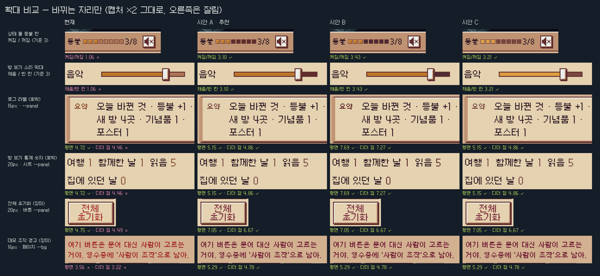
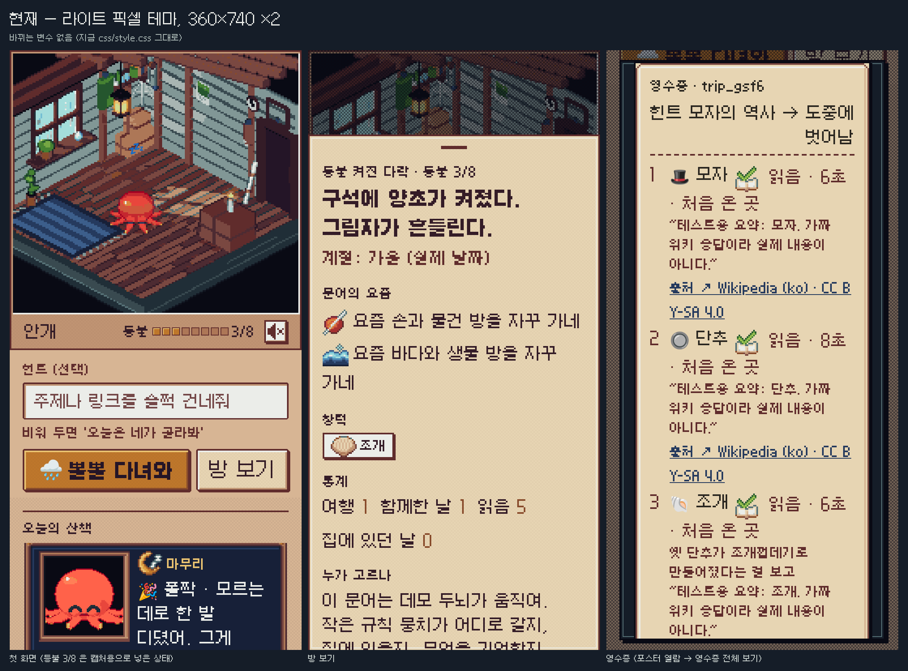
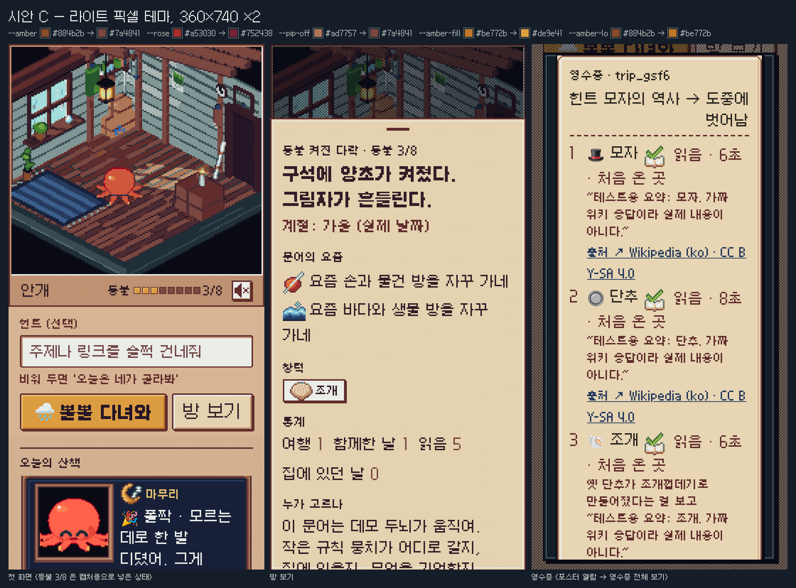

# 라이트 픽셀 테마 대비 시안 (결정거리 4번, 그림만)

- 이 폴더는 그림과 수치뿐이다. `css/style.css` 는 고치지 않았다.
- 시안은 셋(A·B·C)이다. 추천은 **시안 A** 하나다. **결정은 주인이 한다.**
- 색은 모두 `js/palettes.js` 의 Apollo 46색에서만 골랐다. `contrast.js` 가 Apollo 안에 있는지 확인한다.
- 다크 테마는 건드리지 않는다. 시안 변수를 다크 화면에 넣고 토큰을 읽어 봐도 네 경우 모두 그대로였다 (`--amber #e8c170 · --rose #df84a5 · --pip-off #394a50 · --amber-fill #de9e41 · --amber-lo #be772b`).

## 0. 어떻게 만들었나

- 실제 게임을 Playwright 로 열었다. 화면은 360×740, deviceScaleFactor 2, 라이트, 픽셀 글꼴(기본값)이다.
- 이름 짓기 → 힌트 '모자의 역사' → 다녀와 → 건너뛰기로 여행을 한 번 했다. 위키 응답은 가짜다(이 샌드박스에서 ko.wikipedia.org 가 막혀 있다).
- 같은 화면에 시안 변수만 실행 중에 `<style>` 로 넣었다 빼며 찍었다. 그래서 네 장은 내용이 같고 색만 다르다.
- 넣은 규칙은 `:root[data-font="pixel"] { … }` 이다. 라이트 블록과 우선순위가 같고 뒤에 오니 라이트 값만 바뀐다. 다크 블록은 우선순위가 더 높아서 그대로 이긴다.
- 실제로 고칠 때도 `css/style.css` 의 라이트 픽셀 블록(`:root[data-font="pixel"]`, 464~472행)에서 값만 바꾸면 된다. 새 규칙은 필요 없다.
- 캡처용으로 손댄 것은 셋이다. ① 켜진 칸과 꺼진 칸이 나란히 보이게 등불을 3/8 로 직접 넣었다. ② '동작 줄이기'를 켰다. ③ 색 전환 애니메이션(transition)을 껐다.
- 3D 장면은 캔버스라 CSS 변수와 상관없다. 장면 안에서 다른 점은 자는 문어 색이 천천히 바뀌는 것뿐이다(찍은 시각 차이).

## 1. 먼저 다시 잰 것

카드에 적힌 숫자를 WCAG 2.x 상대휘도 공식으로 다시 쟀다. 숫자는 맞다. 다만 그 숫자가 가리키는 바탕이 실제 화면과 조금 다르다.

| 카드의 숫자 | 내가 잰 값 | 실제 화면 |
|---|---|---|
| 호박 글자 3.5:1 | `--amber #884b2b` / `--bg #d7b594` = **3.54** | 화면을 훑어 보니 호박 글자는 `--bg` 위에 **하나도 없다**. 전부 `--panel #e7d5b3` 위에 있다(로그 라벨, 방 보기 통계 숫자, 나가 있는 동안 알약). 평면에서는 **4.72** 로 통과한다. 그런데 패널 칸 절반에 3% 디더 점(캡처 픽셀 `#e2cfae`)이 깔려 있고, 그 점 위에서는 **4.46** 으로 기준에 살짝 못 미친다. |
| 장미 글자 3.5:1 | `--rose #a53030` / `--bg` = **3.56** | 데모 조작 경고 한 줄(`#demo .warn-line`)은 정말 `--bg` 위에 있다. 평면 **3.56**, 6% 디더 점(`#cdac8d`) 위 **3.22** 다. 전체 초기화 버튼은 `--panel` 위라 평면 4.75, 점 위 **4.49** 다. |
| 등불 칸 1.06:1 | `--amber-fill #be772b` / `--pip-off #ad7757` = **1.06** | 맞다. 방 보기의 소리 크기 막대도 같은 두 변수를 써서 채운 쪽과 빈 쪽이 **1.06** 이다. |

덧붙임: `docs/research/a11y-and-mobile-perf.md` 5번은 글자 전용 색으로 `#5d2c28` 와 `#6e2727` 를 제안하면서 "둘 다 Apollo 팔레트 색"이라고 적었다. 확인해 보니 둘 다 Apollo 가 아니다. `#5d2c28` 는 Endesga 64, `#6e2727` 는 Resurrect 64 의 색이다. 이 시안에는 쓰지 않았다.

글자 크기는 16px(Galmuri7)과 20px(Galmuri9)이고 굵기는 보통이다. 큰 글자 기준(24px, 굵으면 18.7px)에 못 미치니 4.5:1 을 적용했다. 디더가 깔린 바탕은 더 어두운 점 픽셀을 기준으로 판정했다(엄한 쪽).

## 2. 한눈에

| | 바뀌는 변수 | 글자 최저 대비 | 켜진 칸 / 꺼진 칸 | 인상 변화 |
|---|---|---|---|---|
| 현재 | — | 3.22 ✗ | 1.06 ✗ | — |
| **시안 A (추천)** | 3개 | 4.78 ✓ | 3.10 ✓ | 작음 |
| 시안 B | 3개 | 4.78 ✓ | 3.43 ✓ | 중간 — 호박 글자 강조가 사라짐 |
| 시안 C | 5개 | 4.78 ✓ | 3.21 ✓ | 큼 — 주 버튼까지 밝은 호박으로 |

장미색은 세 시안 모두 같은 답이다. Apollo 빨강 램프에서 `#a53030` 바로 한 칸 아래인 `#752438` 만 페이지 바탕(디더 점 포함) 위에서 4.5 를 넘는 장미 계열이다. 보라 `#7a367b` 는 4.14 로 모자란다.

Apollo 에는 색마다 공식 이름이 없다. 그래서 아래 표에는 `js/palettes.js` 순번과 램프 안 자리(어두운 쪽부터 1~6)를 적었다.

확대 비교(바뀌는 자리만, 네 경우 나란히): [`compare-zoom.png`](compare-zoom.png)



현재 모습(세 화면): [`current.png`](current.png)



---

## 3. 시안 A — 글자는 나무색, 빈 칸은 어두운 나무 (추천)

| 변수 | 지금 | 새 색 | Apollo |
|---|---|---|---|
| `--amber` | `#884b2b` | **`#7a4841`** | 순번 13 · 갈색 램프 2/6 |
| `--rose` | `#a53030` | **`#752438`** | 순번 26 · 빨강 램프 3/6 |
| `--pip-off` | `#ad7757` | **`#602c2c`** | 순번 19 · 주황 램프 2/6 (지금 `--line`·`--muted` 와 같은 색) |

| 쌍 | 기준 | 지금 | A |
|---|---|---|---|
| 호박 글자 / `--panel` 평면 · 디더 점 | 4.5 | 4.72 · 4.46 ✗ | 5.15 · 4.86 ✓ |
| 장미 글자 / `--bg` 평면 · 디더 점 (데모 경고) | 4.5 | 3.56 · 3.22 ✗ | 5.29 · 4.78 ✓ |
| 장미 글자 / 버튼 `--panel` 평면 · 디더 점 (전체 초기화) | 4.5 | 4.75 · 4.49 ✗ | 7.05 · 6.67 ✓ |
| 켜진 칸 / 꺼진 칸 (등불 · 소리 막대) | 3 | 1.06 ✗ | 3.10 ✓ |
| 꺼진 칸 / 상태 줄 (참고, 경계는 칸 테두리가 맡음) | — | 1.39 | 4.08 |
| (참고) 호박 글자를 `--bg` 위에 놓는다면 | 4.5 | 3.54 ✗ | 3.86 ✗ |


- **인상 (작음):** 빈 등불 칸이 진한 고동색 네모가 되는 것 말고는 종이·나무 느낌이 거의 그대로다. 호박 라벨은 주황기가 빠진 나무 갈색, 장미 글자는 검붉은 와인색이 된다.
- 왜 추천하나: 바꾸는 값이 셋뿐이다. 지금 글자가 놓인 모든 자리에서 디더 점까지 넣어도 통과한다. 화면에서 가장 큰 덩어리(뽈뽈 다녀와 버튼)는 건드리지 않는다. 꺼진 칸이 어두워지는 것은 '불 꺼진 등'이라는 뜻과도 맞는다.
- 약점: 켜짐/꺼짐이 3.10 이라 여유가 0.1 뿐이다(칸은 단색이라 값이 흔들리지는 않는다). 나중에 호박 글자를 `--bg` 위에 바로 놓으면 3.86 으로 떨어진다. 지금은 그런 자리가 없다.

## 4. 시안 B — 호박 글자를 잉크 쪽으로, 빈 칸은 더 어둡게

| 변수 | 지금 | 새 색 | Apollo |
|---|---|---|---|
| `--amber` | `#884b2b` | **`#602c2c`** | 순번 19 · 주황 램프 2/6 (지금 `--muted` 와 같은 색) |
| `--rose` | `#a53030` | **`#752438`** | 순번 26 · 빨강 램프 3/6 |
| `--pip-off` | `#ad7757` | **`#4d2b32`** | 순번 12 · 갈색 램프 1/6 |

| 쌍 | 기준 | 지금 | B |
|---|---|---|---|
| 호박 글자 / `--panel` 평면 · 디더 점 | 4.5 | 4.72 · 4.46 ✗ | 7.69 · 7.27 ✓ |
| 장미 글자 / `--bg` 평면 · 디더 점 | 4.5 | 3.56 · 3.22 ✗ | 5.29 · 4.78 ✓ |
| 장미 글자 / 버튼 `--panel` 평면 · 디더 점 | 4.5 | 4.75 · 4.49 ✗ | 7.05 · 6.67 ✓ |
| 켜진 칸 / 꺼진 칸 | 3 | 1.06 ✗ | 3.43 ✓ |
| 꺼진 칸 / 상태 줄 (참고) | — | 1.39 | 4.52 |
| (참고) 호박 글자를 `--bg` 위에 놓는다면 | 4.5 | 3.54 ✗ | 5.77 ✓ |


- **인상 (중간):** 종이·나무 바탕은 그대로지만, 호박 글자가 흐린 본문 글자(`--muted`)와 같은 색이 되어 강조가 사라지고 화면이 조금 단조롭고 무거워진다.
- 자세히: 로그 라벨과 통계 숫자는 아이콘으로만 구별된다. 빈 칸은 보랏빛이 도는 짙은 갈색이다.
- 좋은 점: 여유가 가장 크다. 나중에 호박 글자를 `--bg` 위에 놓아도 통과한다(5.77).

## 5. 시안 C — 등불을 밝게 (다크 테마의 등불 색을 빌림)

| 변수 | 지금 | 새 색 | Apollo |
|---|---|---|---|
| `--amber` | `#884b2b` | **`#7a4841`** | 순번 13 · 갈색 램프 2/6 |
| `--rose` | `#a53030` | **`#752438`** | 순번 26 · 빨강 램프 3/6 |
| `--pip-off` | `#ad7757` | **`#7a4841`** | 순번 13 · 갈색 램프 2/6 |
| `--amber-fill` | `#be772b` | **`#de9e41`** | 순번 22 · 주황 램프 5/6 (다크 테마와 같은 값) |
| `--amber-lo` | `#884b2b` | **`#be772b`** | 순번 21 · 주황 램프 4/6 (다크 테마와 같은 값) |

| 쌍 | 기준 | 지금 | C |
|---|---|---|---|
| 호박 글자 / `--panel` 평면 · 디더 점 | 4.5 | 4.72 · 4.46 ✗ | 5.15 · 4.86 ✓ |
| 장미 글자 / `--bg` 평면 · 디더 점 | 4.5 | 3.56 · 3.22 ✗ | 5.29 · 4.78 ✓ |
| 장미 글자 / 버튼 `--panel` 평면 · 디더 점 | 4.5 | 4.75 · 4.49 ✗ | 7.05 · 6.67 ✓ |
| `--on-accent` 글자 / `--amber-fill` (뽈뽈 다녀와 · 저장 경고 · 켜진 칩) | 4.5 | 4.84 ✓ | 7.49 ✓ |
| 켜진 칸 / 꺼진 칸 | 3 | 1.06 ✗ | 3.21 ✓ |
| 꺼진 칸 / 상태 줄 (참고) | — | 1.39 | 2.73 |
| 입력칸 포커스 테두리 `--amber-fill` / 입력칸 `--panel2` | 3 | 3.04 ✓ | **1.96 ✗** |



- **인상 (큼):** 화면에서 가장 큰 덩어리(뽈뽈 다녀와 버튼)까지 밝은 노란 호박이 되어, 종이·나무에서 '불 켜진 방' 쪽으로 기운다.
- 자세히: 켜진 등불, 주 버튼, 켜진 칩, 저장 경고 띠, 소리 버튼, 소리 막대가 모두 `#de9e41` 로 바뀐다.
- 나빠지는 점: 힌트 입력칸은 포커스를 받으면 테두리가 `--amber-fill` 로 바뀐다. 이 테두리와 입력칸 안쪽의 대비가 3.04 에서 1.96 으로 떨어진다. 주 버튼 안쪽의 밝은 베벨 줄(`--amber-hi #e8c170`)도 버튼 바탕과 2.10 → 1.35 로 덜 보인다(장식이라 기준 밖).
- 좋은 점: 주 버튼 글자 대비가 4.84 → 7.49 로 오른다.

---

## 6. 같이 볼 것 (변수 밖, 시안에 넣지 않음)

- **이름 짓기 창 아래 정직 표기 한 줄**(`#name-dialog .honest`)은 `css/style.css` 에 `#884b2b` 가 직접 적혀 있다. 변수가 아니다. 대화상자 `--panel` 위 4.72, 디더 점 위 4.46 이다. 어느 시안을 고르든 이 줄은 안 바뀐다. 고칠 때 같은 색(A·C 는 `#7a4841`, B 는 `#602c2c`)으로 같이 바꾸면 된다. 이 창은 첫 실행 때만 떠서 캡처에는 없다.
- **포스터 열람 기록의 기억 장소 강조**(`.kw`)는 `css/ui-art.css` 의 `--accent #884b2b` 다. 종이 틀 위에 있는데, 틀 안쪽은 디더 없는 단색 `#e7d5b3` 이라 4.72 로 통과한다. 시안에서는 바꾸지 않았다. 종이 틀은 다크 테마에서도 같은 것을 쓰므로, 여기를 바꾸면 다크에도 닿는다.
- **입력칸 포커스 테두리의 바깥쪽**(`--amber-fill` 과 `--bg`)은 지금도 1.86 으로 기준 3 아래다. 이 카드 범위 밖이라 표에만 적는다.
- **영수증**은 잉크·종이 토큰(`--ink`, `--ink-muted`, `--ink-link`, 종이 틀)만 쓴다. 그래서 시안 변수가 영수증 안에는 닿지 않는다. 네 장의 영수증 캡처는 픽셀까지 같다. 다른 곳은 시안 C 의 맨 위 12px 하나다(대화상자 뒤로 비치는 '뽈뽈 다녀와' 버튼 색).

## 7. 전체 표와 다시 재기

```sh
node docs/research/light-contrast/contrast.js   # 아래 표를 다시 출력하고, 시안 색이 Apollo 안에 있는지 확인한다
```

| 쌍 | 기준 | 현재 | 시안 A | 시안 B | 시안 C |
|---|---|---|---|---|---|
| 호박 글자 / --panel (로그 라벨 · 통계 숫자 · 나가 있는 동안 알약) | 4.5 | 4.72 ✓ | 5.15 ✓ | 7.69 ✓ | 5.15 ✓ |
|   ↳ 같은 자리, 디더 점 위 | 4.5 | 4.46 ✗ | 4.86 ✓ | 7.27 ✓ | 4.86 ✓ |
| (참고) 호박 글자 / --bg — 지금 이 자리에 호박 글자 없음 | 4.5 | 3.54 ✗ | 3.86 ✗ | 5.77 ✓ | 3.86 ✗ |
| 장미 글자 / --bg (데모 조작 경고 한 줄) | 4.5 | 3.56 ✗ | 5.29 ✓ | 5.29 ✓ | 5.29 ✓ |
|   ↳ 같은 자리, 디더 점 위 | 4.5 | 3.22 ✗ | 4.78 ✓ | 4.78 ✓ | 4.78 ✓ |
| 장미 글자 / 버튼 --panel (전체 초기화) | 4.5 | 4.75 ✓ | 7.05 ✓ | 7.05 ✓ | 7.05 ✓ |
|   ↳ 같은 자리, 디더 점 위 | 4.5 | 4.49 ✗ | 6.67 ✓ | 6.67 ✓ | 6.67 ✓ |
| --on-accent 글자 / --amber-fill (뽈뽈 다녀와 · 저장 경고 · 켜진 칩) | 4.5 | 4.84 ✓ | 4.84 ✓ | 4.84 ✓ | 7.49 ✓ |
| 켜진 칸 / 꺼진 칸 (등불 칸 · 소리 크기 막대) | 3 | 1.06 ✗ | 3.10 ✓ | 3.43 ✓ | 3.21 ✓ |
| 칸 테두리 --line / 상태 줄 --strip 디더 점 (칸과 이웃의 경계) | 3 | 3.89 ✓ | 3.89 ✓ | 3.89 ✓ | 3.89 ✓ |
| (참고) 꺼진 칸 / 상태 줄 — 경계는 위 테두리가 맡음 | — | 1.39 | 4.08 | 4.52 | 2.73 |
| (참고) 켜진 칸 / 상태 줄 — 경계는 위 테두리가 맡음 | — | 1.32 | 1.32 | 1.32 | 1.17 |
| 입력칸 포커스 테두리 --amber-fill / 입력칸 --panel2 | 3 | 3.04 ✓ | 3.04 ✓ | 3.04 ✓ | 1.96 ✗ |

- 바탕 색: `--panel #e7d5b3`(디더 점 `#e2cfae`), `--bg #d7b594`(디더 점 `#cdac8d`), `--panel2 #ebede9`, `--strip #c09473`(디더 점 `#bc9070`). 디더 점 색은 계산이 아니라 캡처 픽셀에서 뽑은 값이다.
- 칸마다 안쪽 1px `--line` 테두리가 있고 칸 사이에는 2px 틈이 있다. 그래서 칸과 상태 줄의 경계는 테두리가 맡는다(3.89). 칸 채움색과 상태 줄의 대비는 참고로만 적었다.
- 캡처를 만든 Playwright 스크립트는 저장소에 넣지 않았다(임시 폴더). 남긴 것은 수치를 다시 재는 `contrast.js` 하나다.
